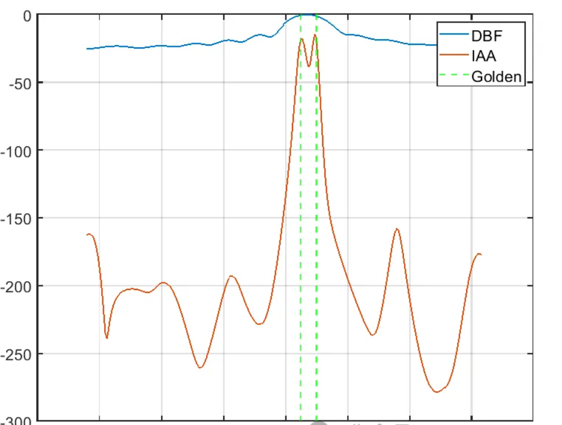

# DOA Estimation - IAA, Iterative Adaptive Approach, iterative adaptive approach to direction finding[with MATLAB code]

The Iterative Adaptive Approach (IAA) estimation algorithm was first proposed by Robert Schmidt and Roy A. Kuc, American electrical engineers and mathematicians, in a paper titled "Multiple Emitter Location and Signal Parameter Estimation" published in 1986. The IAA DOA (Direction of Arrival) estimation algorithm is a method used for estimating the direction of arrival of signals in wireless communication and radar systems, which holds significant importance in the fields of signal processing and communication.
In practical radar DOA estimation, the traditional delay-and-sum method (DAS) has low resolution and significant sidelobe interference. Methods such as ESPRIT2I and MUSIC require sensor numbers greater than source signal numbers, along with a large number of fast shots and high signal-to-noise ratios to achieve high resolution. However, in real engineering applications, collecting a large number of fast shots is impractical, especially in rapidly changing environments where this is difficult to achieve, leading to deteriorated positioning performance. Additionally, due to its sensitivity to subspace orthogonality, methods based on subspaces cannot handle coherent sources.
The IAA is an iterative adaptive algorithm that relies on data and uses a weighted least squares method (WLS), a nonparametric approach. It can provide good parameter estimation in scenarios with few fast shots (even one), coherent or noncoherent sources, and arbitrary arrays. Compared to other data-dependent methods, IAA can significantly increase resolution and reduce sidelobes, thus outperforming existing spatial sparse signal reconstruction algorithms.
The common issues with array signal processing are the small number of fast-sampling points and low signal-to-noise ratio. Applying the IAA algorithm can effectively mitigate these adverse factors on signal estimation. Since actual signals often consist of much fewer samples than observed ones, converting array signal processing problems to the field of sparse signal representation is apt. Sparse signal representation methods can handle cases with only a few fast-sampling points, even one. This method based on sparse representation has also been applied in spectrum estimation, image processing, array design, and many other fields.
Principle Link of IAA Algorithm:
IAA Algorithm Code:
IAA Algorithm Code:
% IAA\n% P = a'R^-1X/(a'R^-1a)\nclc; clear; close all; \n\n\n%% Initial signal\n% IAA can work on one or more snapshots, this work just show one snapshot\nT = 1; \nsnsrMap = [1; 2; 3; 4; 5; 6; 7; 8; 9; 10; 11; 12]; \ntThetas = [5; 10]; \n[X, tA] = arrayModel(snsrMap, T, tThetas); \ntS = pinv(tA' * tA) * tA' * X; \n\n\n%% Initial scan grid\npThetas = -64:0.5:63.5; \npThetas = pThetas .'; \npA = exp(1i * pi * (snsrMap - 1)* sind(pThetas).'); \npA = pA ./ norm(pA(:, 1)); \n\n\n%% DBF\npDBF = zeros(size(pThetas)); \nfor i = 1: length(pThetas)\n    pDBF(i) = pinv(pA(:, i)' * pA(:, i)) * pA(:, i)' * X(:, 1); \nend\n\n\n%% IAA\nR = X * X' ./ T; \nmaxIter = 16; \nP = diag(abs(pDBF).^2); \nfor i = 1: maxIter\n    Q = R - pA * P * pA'; \n    invQ = pinv(Q); \n    aS = zeros(size(pThetas)); \n    for j = 1: length(pThetas)\n        aS(j) = pA(:, j)' * invQ * X / (pA(:, j)' * invQ * pA(:, j)); \n    end\n    figure(2); \n    plot(abs(aS)); \n    P = diag(abs(aS) .^2); \nend\n\n\n%% Figure; \nfigure; \nplot(pThetas, 20 * log10(abs(pDBF) / max(abs(pDBF)))); \nhold on; \nplot(pThetas, 20 * log10(real(P) / max(real(P)))); \nfor i = 1: length(tThetas)\n    xline(tThetas(i), '--g'); \nend\nlegend("DBF", "IAA", "Golden")\ngrid on; IAA simulation results
\n        \n  

## Images

<!-- PAYMENT_BLOCK -->

## Get this dataset

- Payment link (Stripe): [Buy now](https://buy.stripe.com/3cs8yP7sY87d0vu9AB)
- Payment QR code: 

<!-- /PAYMENT_BLOCK -->
